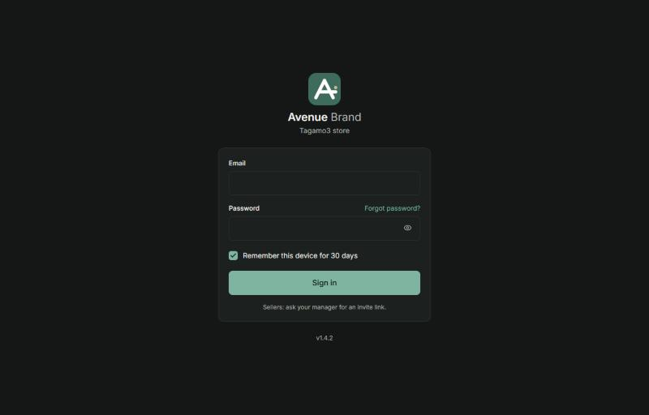
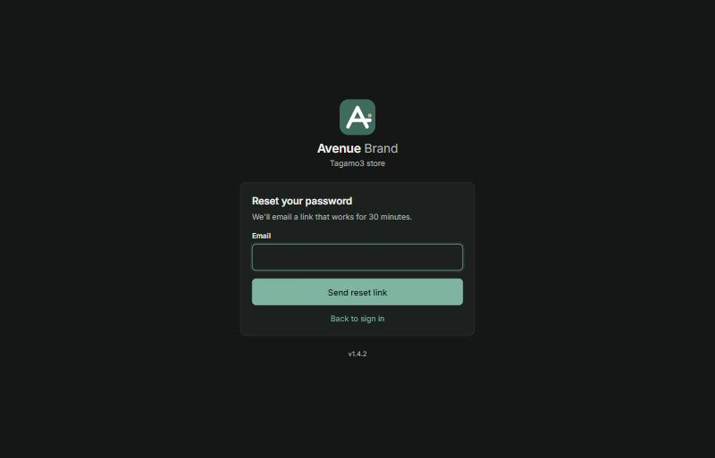

<p align="center">
  
</p>

<h1 align="center">Avenue Brand</h1>

<p align="center">
  Inventory, point of sale and reporting for a single clothing store whose products come in sizes and colours.<br/>
  One Next.js app serves the API and the installable web app for <b>Admin</b>, <b>Manager</b> and <b>Seller</b>.
</p>

<p align="center">
  <a href="https://avenue-stock.vercel.app"><b>Live demo →</b></a>
  &nbsp;·&nbsp;
  <a href="docs/BRAND.md">Brand kit</a>
  &nbsp;·&nbsp;
  <a href="docs/API-SPEC.md">API</a>
  &nbsp;·&nbsp;
  <a href="docs/DATA-MODEL.md">Data model</a>
</p>

---

## Contents
- [Brand kit](#brand-kit)
- [Screens](#screens)
- [Features](#features)
- [Tech stack](#tech-stack)
- [How it works](#how-it-works)
- [Getting started](#getting-started)
- [Scripts](#scripts)
- [Environment variables](#environment-variables)
- [Deployment](#deployment)
- [Testing and CI](#testing-and-ci)
- [Security](#security)
- [Project layout](#project-layout)
- [Documentation](#documentation)

---

## Brand kit

Calm, quiet, confident — a well-run boutique's back office. One mark, one typeface, one accent, used sparingly. The full spec lives in [`docs/BRAND.md`](docs/BRAND.md).

### Logo

<table>
  <tr>
    <td align="center" width="25%">
      <br/>
      <sub><b>Mark</b><br/>sage tile, white glyph, sand hanger dot</sub>
    </td>
    <td align="center" width="25%">
      <br/>
      <sub><b>Lockup · light</b><br/>mark + wordmark</sub>
    </td>
    <td align="center" width="25%" bgcolor="#141715">
      <br/>
      <sub><b>Lockup · dark</b></sub>
    </td>
    <td align="center" width="25%">
      <br/>
      <sub><b>Wordmark</b><br/>Inter 600 + 400, −0.02 em</sub>
    </td>
  </tr>
</table>

The glyph is an **"A"** whose crossbar runs on as a clothes rail, with a sand dot for the hanger — *stock on the rail*. Clear space equals the height of the crossbar stroke. Minimum size 20 px (tile), 10 px (mono glyph).

### Colour

| | Token | Light | Dark | Role |
|:-:|---|:-:|:-:|---|
|  | `--accent` sage | `#3F6B5C` | `#7FB5A0` | Primary actions, active nav, chart line |
|  | `--accent-soft` | `#E3EDE8` | `#223229` | Selected states, tints |
|  | sand | `#C8B89A` | `#C8B89A` | Hanger dot, underline rule — never text |
|  | `--bg` | `#F7F6F3` | `#141715` | Page |
|  | `--surface` | `#FFFFFF` | `#1C201E` | Cards, sheets |
|  | `--ink` / `--ink-2` | `#1F2421` / `#5B625D` | `#ECEEEB` / `#AEB5B0` | Text |
|  | status · ok | `#2F7D5B` | lighter | — |
|  | status · warn | `#B7791F` | lighter | — |
|  | status · danger | `#B04A3F` | lighter | — |
|  | status · info | `#3D6A8A` | lighter | — |

Every token is defined once in [`src/app/globals.css`](src/app/globals.css).

### Type, shape & motion

- **Type** — Inter (self-hosted via `next/font`). Headings 600, body 400, labels 11 px / 600 / 0.08 em small caps. Numbers always tabular-nums. Base 15 px on phones, 14 px on desktop tables.
- **Shape** — 12 px card radius, 8 px inputs, 16 px mark tile (at 64). 1 px `--line` borders. One soft shadow for floating sheets and menus only.
- **Motion** — 150–200 ms ease-out. Sheets slide up, drawers slide in from the right, nothing bounces.
- **Voice** — Short, specific, calm. Numbers in EGP with two decimals. No exclamation marks. Errors say what happened and that nothing was changed.

---

## Screens

Both light and dark themes are first-class — every page is built from the same tokens and reads the viewer's system preference.

<table>
  <tr>
    <td align="center" width="50%">
      <a href="https://avenue-stock.vercel.app/login"></a><br/>
      <sub><b>Sign in</b> · the public landing. Dark theme shown.</sub>
    </td>
    <td align="center" width="50%">
      <a href="https://avenue-stock.vercel.app/forgot"></a><br/>
      <sub><b>Password reset</b> · 30-minute email link.</sub>
    </td>
  </tr>
</table>

**Behind the sign-in** — the app is organised around five job-to-be-done surfaces:

| Surface | Routes | What it is |
|---|---|---|
| **Dashboard** (Admin/Manager) | `/dashboard` | Today's sales, profit & margin trend, low-stock watchlist, top products, recent audit activity. |
| **Catalogue** | `/products`, `/products/new`, `/products/:id` | Product list with filters, product detail with a size × colour variant matrix, inline edit, image upload. |
| **Point of sale** (Seller) | `/home`, `/sales/new`, `/sales/:id` | Scan-to-add cart, parking, discounts within the seller cap, receipt sized for an 80 mm roll. |
| **Stock** | `/stock/purchases`, `/stock/adjustments`, `/stock/counts`, `/stock/low` | Receiving, reason-coded adjustments, counts, low-stock & out-of-stock lists. |
| **Reports** | `/analytics/*` | Sales, profit, payment mix, top products, sellers, returns, slow movers, stock ageing, price list — each with a CSV export. |
| **Administration** | `/users`, `/settings`, `/audit`, `/notifications` | Invitations, temp passwords, store settings, audit log, in-app notifications. |

Every view is built from the same primitives (`Button`, `Field`, `Card`, `Badge`, `Chip`, `ColorSwatch`, `VariantMatrix`, `Combobox`, `PickerMenu`, `BarcodeCaptureButton`). Open the [live demo](https://avenue-stock.vercel.app) to walk through all of them.

---

## Features

**Catalogue**
- Products with a size × colour matrix of variants, each with its own SKU, barcode, cost, price and low-stock threshold.
- Brands, a category tree (for example `Footwear / Sneakers`) and suppliers.
- Size dropdown with store presets, letter, waist and shoe runs (footwear gets EU 30–50). Colour dropdown with common clothing colours, plus custom colours picked by name or with the phone's colour picker.
- Product photos stored on Vercel Blob, re-encoded on upload.
- CSV import with a dry run (row-by-row errors, all-or-nothing commit) and CSV export that re-imports unchanged.
- Barcode scanning with the phone camera (EAN, UPC, Code 128/39, QR) with a beep on success, both at checkout and when labelling a variant. Printable barcode labels.

**Selling**
- Point of sale with scanning, cart parking, discounts (with a seller discount cap), cash, card, wallet and transfer payments.
- Receipts sized for an 80 mm roll. On phones, **Print** produces a PDF and opens the share sheet.
- Returns with refunds that never exceed what was paid, and voids. Every request that takes money is protected against double submission.

**Stock**
- A ledger: every quantity change is a stock movement, so stock can always be reconciled.
- Receiving against purchases, adjustments with reasons, stock counts, and low and out-of-stock lists.

**Reporting**
- Dashboard and analytics in the store's timezone: sales, profit and margin trend, payment mix, top products and variants, brands, categories, size × colour, sellers, returns, slow movers, stock ageing, price list. CSV export for each report.

**Team and administration**
- Users with invitations (48-hour link) or temporary passwords, forced password change, password reset by email, session revocation.
- Settings (store details, timezone, receipt text, discount cap, session lengths, presets), a searchable audit log, and in-app notifications (low stock, large refunds, new-device sign-ins, password resets, system alerts).
- Branded HTML emails for invitations and password resets.

**Operations**
- A daily maintenance cron: purges, a daily private backup that replaces the previous one, and a weekly stock reconciliation.
- An admin-only full data export (zip of CSVs), a health check, structured logs with request ids.
- An installable PWA with an offline page.

## Tech stack

| Area | Choice |
|---|---|
| App | Next.js 15 (App Router), React 19, TypeScript strict, Tailwind CSS 4 |
| Data | Neon Postgres, Drizzle ORM (`drizzle-orm/neon-serverless`, interactive transactions), drizzle-kit migrations |
| Validation | Zod (strict schemas everywhere) |
| Auth | Server-side sessions in httpOnly `__Host-` cookies, Argon2id password hashing (`@node-rs/argon2`) |
| Rate limits | Upstash Redis + `@upstash/ratelimit` |
| Files | Vercel Blob (public store for images, private store for backups) |
| Email | Resend |
| Tests | Vitest on PGlite (Postgres in-process, real migrations) |
| Hosting | Vercel (Hobby), Vercel Cron |
| Package manager | pnpm 12 |

## How it works

- **Thin route handlers.** Every route under `src/app/api/v1/**/route.ts` follows the same steps: parse with a strict Zod schema, authorise with `withAuth({ permission })`, call a service, serialise. Business rules live in `src/services/`, and transactions start and end there.
- **Stock only moves through the ledger.** `applyMovement()` in `src/services/stock.ts` is the only code that changes a variant's quantity. It locks the variant row (`SELECT … FOR UPDATE`) and writes a stock movement in the same transaction. `pnpm stock:verify` checks that every quantity equals the sum of its movements.
- **Money is integer minor units** (piastres) everywhere. Totals, discounts, refunds, sale numbers and permissions are computed on the server; values sent by the browser are only hints.
- **Role-aware output.** Sellers never receive cost, margin or profit fields; serializers strip them, and a test scans every seller-visible endpoint for them.
- **Everything is audited.** Each change writes an audit row with before and after values. Errors always use the same envelope, `{ error: { code, message, fields? } }`, and never include stack traces.
- **One source of truth for reports.** Analytics are SQL-first (`src/analytics/`) and built on shared fact queries, so the dashboard, per-sale profit and CSV exports agree.

## Getting started

Requirements: **Node 22**, **pnpm 12** (`npm i -g pnpm@12`) and a Neon project (the free tier is enough). Upstash, Resend and Blob are optional locally. Without them the app uses an in-memory rate limiter, logs emails instead of sending them, and refuses uploads.

```bash
pnpm install
cp .env.example .env      # set DATABASE_URL, DATABASE_URL_UNPOOLED, SETUP_TOKEN
pnpm db:migrate           # apply drizzle/*.sql
pnpm dev                  # http://localhost:3000
```

**Create the first admin:** open `http://localhost:3000/setup` and enter your `SETUP_TOKEN`. Setup works only while there are no users.

**Optional demo data:** `pnpm db:seed` adds a demo catalogue (only when no brands exist yet). `pnpm db:seed-users` adds a demo manager and two sellers with random passwords. Use both on development databases only.

**Testing on a phone over your LAN:** run `pnpm dev -H 0.0.0.0` and open `http://<your-computer-ip>:3000`. The camera scanner needs HTTPS, so use `next dev --experimental-https` or the deployed site to test scanning.

**Calling the API directly:** every mutating request must send the browser `Origin` and the header `X-Requested-With: AvenueStock`, or it is rejected with 403. This is the protection against cross-site request forgery.

## Scripts

| Script | What it does |
|---|---|
| `pnpm dev` / `pnpm build` / `pnpm start` | Dev server, production build, serve the build |
| `pnpm typecheck` / `pnpm lint` / `pnpm test` | TypeScript, ESLint, Vitest |
| `pnpm db:generate` | Create a migration from `src/db/schema/*` |
| `pnpm db:migrate` | Apply migrations to `DATABASE_URL_UNPOOLED` (falls back to `DATABASE_URL`) |
| `pnpm db:seed` | Demo catalogue, only when no brands exist |
| `pnpm db:seed-users` | Demo staff accounts, development only |
| `pnpm db:seed-big` | About 10,000 sales for performance checks, development only |
| `pnpm stock:verify` | Reconcile every variant's quantity against the ledger |
| `pnpm secrets:scan` | Scan tracked files for leaked keys and tokens |

## Environment variables

All variables are listed with comments in `.env.example`. Production refuses to start if a required one is missing, so the app never silently falls back to in-memory limits or unsent email.

| Variable | Production | Purpose |
|---|---|---|
| `DATABASE_URL` | required | Neon pooled connection used at runtime |
| `DATABASE_URL_UNPOOLED` | recommended | Neon direct connection used by migrations |
| `APP_URL` | required | Public address, e.g. `https://avenue-stock.vercel.app`. Used for email links and the cross-site request check |
| `SETUP_TOKEN` | required | One-time token for `/setup` (at least 16 characters, `openssl rand -hex 16`). Rotate after setup |
| `UPSTASH_REDIS_REST_URL` / `UPSTASH_REDIS_REST_TOKEN` | required | Shared rate limits. The `KV_REST_API_URL` / `KV_REST_API_TOKEN` names injected by the Vercel Upstash integration also work |
| `RESEND_API_KEY` / `EMAIL_FROM` | required | Invitation and password-reset email. Without a verified domain, Resend only delivers to the account owner |
| `BLOB_READ_WRITE_TOKEN` | for photos | Public Vercel Blob store for product images |
| `BACKUP_BLOB_READ_WRITE_TOKEN` | for backups | Private Vercel Blob store for the daily backup `backups/latest.zip` (falls back to `BLOB_READ_WRITE_TOKEN`) |
| `CRON_SECRET` | for cron | At least 32 characters; Vercel sends it as `Authorization: Bearer …` to `/api/v1/cron/daily` |
| `SESSION_SECRET` | optional | Reserved for signing non-session cookies |
| `LOG_LEVEL` | optional | pino log level, default `info` |
| `NEXT_PUBLIC_USE_MOCK` | never | `1` runs the UI against an in-browser mock store, for design work only |

On Vercel, also set `ENABLE_EXPERIMENTAL_COREPACK=1` so the build uses pnpm 12.

## Deployment

The app runs on free tiers: Vercel Hobby, Neon, Upstash, Vercel Blob and Resend. The full walkthrough, with a go-live checklist, is in [`docs/DEPLOYMENT.md`](docs/DEPLOYMENT.md). In short:

1. Create the Neon database, the Upstash Redis database (via the Vercel Marketplace), a public Blob store for images, a private one for backups, and a Resend API key.
2. Set the environment variables above in Vercel for Production and Preview. Previews should use a Neon branch, never the production database.
3. Run migrations before deploying any change that adds a file under `drizzle/`:
   ```bash
   DATABASE_URL_UNPOOLED=<direct url> pnpm db:migrate
   ```
   Migrations never run inside the Vercel build; parallel builds would race.
4. Deploy (`vercel deploy --prod`, or by connecting the GitHub repo in Vercel), then open `/setup` once to create the admin.
5. The daily cron in `vercel.json` (`0 2 * * *` UTC) runs the purges and overwrites the backup `backups/latest.zip`, and on Sundays (store time) the stock check. Trigger it once from Vercel → Cron Jobs to confirm.

Health check: `GET /api/v1/health` returns `{ "ok": true, "db": "up" }`, or 503 when the database is unreachable.

## Testing and CI

```bash
pnpm test                          # full suite on PGlite, no database needed
PERF=1 pnpm vitest run tests/perf  # EXPLAIN checks on a 10k-sale dataset
```

- Every endpoint has at least a success test and a permission test.
- `tests/authz/matrix.test.ts` checks every route in `src/lib/route-manifest.ts` for every role, and fails if a route file is missing from the manifest.
- `tests/concurrency/` runs parallel sales against a real Postgres to prove the stock locks. It runs when `DATABASE_URL_TEST` is set.

GitHub Actions (`.github/workflows/ci.yml`) runs on every push to `main` and `sprint-*` branches and on every pull request:
- lint, typecheck and tests
- a migration drift check (`db:generate` must produce no changes)
- `drizzle-kit check`
- `pnpm audit --audit-level=high`
- the secrets scan
- a separate job that runs the concurrency tests on a Postgres 16 service

Dependabot opens weekly update pull requests.

## Security

The full requirements and threat notes are in [`docs/SECURITY.md`](docs/SECURITY.md). Highlights:

- **Passwords:** Argon2id, at least 10 characters, common passwords rejected.
- **Account lockout:** after repeated failures, with rate limits on login, password reset, setup and password change.
- **Sessions:** server-side, stored as hashes, `__Host-` httpOnly Secure SameSite=Lax cookies, idle and absolute expiry. They are revoked on password change, disable or role change.
- **Peer resets are visible:** only an Admin can manage Admin accounts. A password reset by a manager emails the account owner and notifies every Admin.
- **Headers and request checks:**
  - A strict Content Security Policy with a per-request nonce.
  - HSTS, which keeps browsers on HTTPS, with preload.
  - The `X-Frame-Options: DENY`, `nosniff`, `Referrer-Policy` and `Permissions-Policy` headers.
  - A cross-site request check on every API mutation.
- **Untrusted input:**
  - Uploads are checked by their real file signature and re-encoded.
  - CSV exports neutralise spreadsheet formulas.
  - NUL bytes are rejected.
  - Search input is escaped.

Report security issues privately to the repository owner, not as a public issue.

## Project layout

```
src/
  app/api/v1/**/route.ts   thin route handlers: parse → authorise → service → serialise
  app/(app)/**             signed-in pages (dashboard, sell, products, stock, sales, users, settings…)
  app/(auth)/**            login, setup, password reset, invitation
  db/schema/*.ts           tables by area: auth, catalog, stock, sales, system
  db/migrate.ts  seed.ts   migrations runner and demo seed
  services/*.ts            business logic and transaction boundaries
  analytics/*.ts           SQL-first report queries
  serializers/*.ts         role-aware output (sellers never see cost or profit)
  schemas/*.ts             strict Zod input schemas
  lib/                     auth, permissions, money, audit, rate limits, email templates, HTTP helpers
  screens/  components/    UI screens and shared components
drizzle/                   generated SQL migrations (each with a rollback note)
tests/                     Vitest suites per route group and service
scripts/                   seed-big, seed-users, scan-secrets
docs/                      specifications, decisions, deployment, sprint plans
public/                    manifest, service worker, icons
```

## Documentation

| File | Contents |
|---|---|
| [`docs/DATA-MODEL.md`](docs/DATA-MODEL.md) | Tables, invariants and derived rules |
| [`docs/API-SPEC.md`](docs/API-SPEC.md) | Every endpoint with body, response and permission |
| [`docs/ACCESS-MATRIX.md`](docs/ACCESS-MATRIX.md) | Roles × permissions × pages |
| [`docs/SECURITY.md`](docs/SECURITY.md) | Security requirements and threat notes |
| [`docs/DEPLOYMENT.md`](docs/DEPLOYMENT.md) | Free-tier deployment and go-live checklist |
| [`docs/DECISIONS.md`](docs/DECISIONS.md) | Log of design decisions and their reasons |
| [`docs/BRAND.md`](docs/BRAND.md) | Logo, colours and tone of voice |
| [`docs/SPRINTS.md`](docs/SPRINTS.md) | Build plan, sprint by sprint, and the Phase 2 backlog |
| [`CLAUDE.md`](CLAUDE.md) | Working rules for AI-assisted development in this repo |
